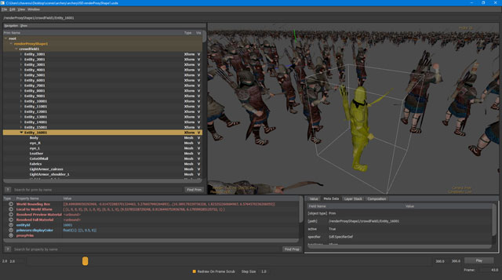

# Golaem For USD



Golaem For USD provides a USD file format for Golaem simulation caches (`.glmusd`) that uses USD Dynamic Payloads, as well as a Hydra generative procedural plugin. It renders Golaem characters without baking their geometry into USD, while preserving geometry and shading variation and Golaem layout edits.

The Hydra procedural is available when building against USD 0.25.06 or newer. See [HYDRA.md](HYDRA.md) for its format and supported attributes.

## License
Golaem For USD is licensed under Apache 2.0

See [license file](LICENSE.md)

## Contributing
You can find more information about how to contribute to this project [here](CONTRIBUTING.md)

## Prerequisites
- CMake 3.25 or newer.
- A Golaem For Maya Devkit matching the Golaem For USD version being built.
- A compatible USD distribution and toolchain. See [CHANGELOG](CHANGELOG) for the supported USD and host application versions for each release.
- Autodesk FBX SDK for standalone USD builds. CMake defaults to FBX SDK 2020.3.9; use a version and platform build compatible with your Golaem Devkit and USD distribution.

## Documentation
Official documentation for the plugin can be found here: [http://usd.golaem.com](http://usd.golaem.com)

## Compilation
For a standalone USD build, configure CMake with the paths to your externals and Golaem Devkit. The USD and FBX SDK packages must match your platform and toolchain:

```sh
cmake -S . -B build \
  -DGOLAEMUSD_STANDALONE_BUILD=ON \
  -DGLM_EXTERNALS_HOME=/path/to/externals \
  -DGOLAEMDEVKIT_ROOTDIR=/path/to/golaem-devkit \
  -DUSD_VERSION=0.25.11-glm-onetbb2021.12 \
  -DFBXSDK_VERSION=2020.3.9
cmake --build build --config Release
cmake --install build --config Release
```

`GOLAEMUSD_STANDALONE_BUILD` is enabled by default. The example variables configure the external packages and Golaem Devkit used by the standalone build.

## Changelog
Changelog for the plugin can be found here: [CHANGELOG](CHANGELOG)

## Code of Conduct

### Our Pledge

We as members, contributors, and leaders pledge to make participation in our community a safe, inclusive and harassment-free experience for everyone, regardless of age, body size, visible or invisible disability, ethnicity, sex characteristics, gender identity and expression, level of experience, education, socio-economic status, nationality, personal appearance, race, religion, or sexual identity and orientation. We pledge to act and interact in ways that contribute to an open, welcoming, diverse, inclusive and healthy community.

### Our Standards

Our Open Source Community works to:

- Be kind towards other people which enables us to be empathic to each other
- Be respectful of differing opinions, viewpoints, and experiences
- Give and gracefully accept constructive feedback
- Accept responsibility and apologize to those affected by our mistakes, and learning from the experience
- Focus on what is best not just for us as individuals, but for the overall community

We will not tolerate the following behaviors:

- Violent threats or language
- The use of sexualized language or imagery, and sexual attention or advances of any kind
- Trolling, insulting or derogatory comments, and personal or political attacks
- Public or private harassment
- Publishing others’ private information, such as a physical or email address, without their explicit permission
- Other conduct which could reasonably be considered inappropriate in a professional setting